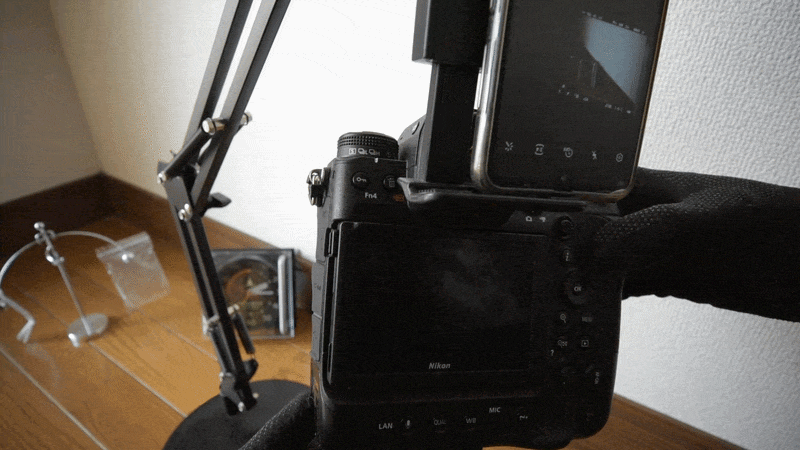

> Published: 2026-05-17 | Last Updated: 2026-11-08

# An Analysis of Display 5 (“Info”) Persistence in Nikon Z-Series Cameras: The Case of the Nikon Z f

On my personal mirrorless camera, the Nikon Z f, while the Info display is on the LCD monitor, I encountered the following situations:

* **A shutter-release button half-press fails to switch the display back to the through-the-lens image.**
* **This state is maintained even after turning the power on/off or disconnecting the power.**

This behavior can depart from a photographer’s natural expectations and may lead to missed photo opportunities.

 Initially, I suspected this was simply a bug unique to this camera. However, following formal inquiries with Nikon Support in Japan, several of these and other Info display behaviors have been officially confirmed by the manufacturer to be exactly the same not only on the Z f but also on the Z9 and Z8. Therefore, to uncover the specific triggering conditions and identify potential workarounds, I conducted detailed behavioral observations.

I hypothesize that the phenomena observed here represent the challenges of carrying over the “Information Display (Info)”—a feature inherited from the D-series DSLRs—into mirrorless cameras. Specifically, it may be a visible manifestation of the conflict between legacy and modern system logic, as well as the discrepancy between software consistency and human-expected behavior.

Although I am a complete layman in the field of systems engineering, I share this report in the hope that it will spark meaningful discussions among experts and specialists in the community.
As this analysis was conducted independently by a non-specialist, some terminology or interpretations may be incomplete.

*In this repository, the term “persistence” is used operationally to describe a state in which the camera remains on, or repeatedly returns to, the Info display despite ordinary shooting-recovery operations.It reflects behavior that appears unnatural from the standpoint of consistency with long-standing Nikon shooting-operation expectations—particularly the expectation that a half-press should promptly restore a shooting-ready view.The term does not by itself imply a conclusion regarding Nikon’s internal firmware intent. *

---

## Quick Reading Guide

Readers who want the shortest path to the core issue may begin with:

- [Mechanism via State Transition Diagram](./Mechanism_via_State_Transition_Diagram/README.md)
- [Nikon Support Confirmations](./Nikon_Support_Confirmation_Notes/README.md)
- [Insights & Hypotheses](./insights.md)
- [Post-Publication Updates](./post-publication-updates.md)

*For Japanese readers: 「考察および仮説」の日本語版はこちら:* [考察および仮説 (日本語版)](./insights_ja.md)

These documents provide the main route through the issue: transition diagrams focusing on the problematic areas along with the observed phenomena, the interpretive models for understanding the behavior on-site during shooting, extensive discussions on topics such as the role of the equipment, and subsequent updates to the analysis.

---

## 1. Project Overview

### 1.1 Objective

- Visualization of state transitions involving the "Information Display (Info)" on the Nikon Z f.
- Logical analysis of display priority, state persistence, and the coexistence of legacy and modern architectures within the system under specific operational conditions.
- A comprehensive study based on operational confirmations from Nikon Support regarding the camera's display behavior and transition logic.
- Supplementary observations utilizing a Nikon Z9 procured for testing.

### 1.2 Historical Context

The “Info” display in Nikon cameras historically functioned as a temporary shooting-information screen.

Introduced prominently during the DSLR era (e.g., Nikon D3 generation), the Info display was accessed via a dedicated “INFO” button and Nikon manuals explicitly documented how to dismiss the screen, including:
- half-pressing the shutter-release button,
- pressing the INFO button,
- or waiting for timeout.

This behavior and terminology remained consistently documented through multiple DSLR generations.

However, with the EXPEED 6 generation and the launch of the Nikon Z system, including the first Z-series cameras and later DSLRs such as the D780 and D6, such dismissal instructions appear to disappear from the manuals.

This does not prove that EXPEED 6 itself caused the behavioral change. 
Nonetheless, the timing suggests that the role of the Info display may have been reconsidered during the transition from DSLR-era temporary Info screens to the Display (“Info”) in EXPEED 6-generation Z-series cameras, which likely led to Display 5 (“Info”) as a persistent display mode in EXPEED 7.

| Era                  | Info access method                     | Manual                                         | Actual behavior        |
| -------------------- | -------------------------------------- | ---------------------------------------------- | ---------------------- |
| D3(EXPEED),  D4(EXPEED3),  D5(EXPEED5) | Dedicated INFO button                | “Info can be turned off” explicitly documented | half-press clears Info |
| Z7/Z6(EXPEED 6)      | Integrated into DISP cycle             | documentation removed                          | unknown                |
| D780 (EXPEED 6)      | Dedicated INFO button                | documentation removed                          | unknown                |
| D6 (EXPEED 6)        | Dedicated INFO button                | documentation removed                          | half-press still works |
| Z9/Z8/Zf (EXPEED 7)  | Integrated into DISP cycle   (Display 5) | documentation removed                     | Display5 persistence   |

This repository does not attempt to infer Nikon’s internal design intentions.
However, the observed transition in documentation and device behavior appears to coincide with the introduction of the Z system and may be historically significant.

### 1.3 Observed Phenomena 

* **Display Priority Persistence:** The "Information Display (Info)" appears to preempt or retain display priority over other operational displays under certain conditions.
* **Recovery Path Removal Through Configuration:** Certain customizations can make standard UI-level recovery paths inaccessible without any explicit system warning.
* **State Persistence:** The status of the "Information Display (Info)" is maintained (resumed) even after cycling the power.
* **Inconsistency of Internal States:** Even when the visual appearance remains identical, the system's response (output) to inputs varies depending on past display history.
* **Persistent Info Display Under Specific Modes:** Under specific conditions such as continuous shooting mode, the "Information Display (Info)" persistently occupies the entire LCD when the user's eye is removed from the viewfinder.

### 1.4 Target Environment

- **Primary Device:** Nikon Z f (Firmware: [ C: Ver. 3.01 ])
- **Supplementary Device:** Nikon Z9 (Firmware: [ C: Ver. 4.00 ]) Procured for testing, Nikon D6

### 1.5 Notes on the Observation Process

The cases in this repository were developed chronologically through observation, rather than from a predefined state model.

Over time, these observations revealed inconsistencies, hidden dependencies, and visually identical states exhibiting different operational behaviors. Consequently, state definitions and transition interpretations evolved throughout the investigation process.

For this reason, earlier tables intentionally preserve the original coarse-grained observations, including ambiguities and apparent inconsistencies that later motivated finer-grained analyses.

Ultimately, this repository is not merely a collection of transition tables, but also a chronological observational record documenting how the underlying display-state structure gradually became visible.

---

## 2. Structure of Data

The detailed observation tables serve as the reference layer for this repository.

They provide the raw observation records, the state definitions, and the step-by-step transition data used to support the analysis. 
They are included for traceability and reproducibility rather than as the main narrative.
Note that these transition tables and state definitions also serve as a chronological record, reflecting how an individual user perceived and analyzed this phenomenon over time.
**During the Phase 2 (Fine-grained) analysis, states of the Info display that are visually indistinguishable were separated by tracing their arrival paths and subsequent behaviors, and then consolidated into the Info-State Classification.**

For the current interpretation of the issue, readers should refer first to the mechanism via state transition diagram, support confirmations, insights documents, and post-publication-updates.

For the underlying test sequences and state labels, refer to the tables below.

### Phase 1: Definition A (Coarse-grained)
- [DA README with State Definition A (Coarse-grained Analysis)](./docs/DA/README.md)

<i>Case A1, Case A2</i>

 [**Case A1:** Schrödinger's Sisyphean Loop](./docs/DA/Case_A1_Schrodinger.md)
  This case records the initial observations that motivated the repository: half-press did not always restore Live View, and visually identical states could produce different outcomes depending on prior display history.

 [**Case A2:** Deterministic Loop: Immediate Transition from Default Settings](./docs/DA/Case_A2_Deterministic.md)
  This case records how a minimal operation under factory-default settings can transition the camera into persistent Info-display behavior, and how subsequent customization can unintentionally disable simple recovery routes without warning.

### Phase 2: Definition B (Fine-grained)
- [DB README with State Definition B (Fine-grained Analysis) and Info-State Classification](./docs/DB/README.md)

<i>Case B1, Case B2, Case B3</i>

 [**Case B1:** The Shadow Double](./docs/DB/Case_B1_Shadow.md)
  This case examines multiple activation pathways into visually similar Info displays, including Display 5 as configured under [d19 Custom monitor shooting display] and non-Display 5 routes. It compares their behavior and identifies pathways that lead to persistent display states.

 [**Case B2:** In the Fray of the Focus](./docs/DB/Case_B2_Fray.md)
  While earlier cases focus mainly on pre-shooting display states, this case examines behavior during shooting operations. It records observations in which Info-display persistence remains active even during continuous shooting, depending on the display configuration.

 [**Case B3:** Cornering the Shadow: A Trace from the Past](./docs/DB/Case_B3_Cornering.md)
  This case investigates boundary conditions of the persistent Info behavior, including LCD activation thresholds, overlay routes, Display 5 ON/OFF differences, and cases where prior display history reappears through later recovery behavior.

---

## 3. Mechanism via State Transition Diagram

- [Mechanism via State Transition Diagram README](./Mechanism_via_State_Transition_Diagram/README.md)

---

## 4. Nikon Support Confirmation Notes
Operational confirmations on the actual device were obtained from Nikon Support in Japan out of practical necessity.
I am deeply grateful for their kind cooperation.

- [Nikon Support Confirmation Notes README](./Nikon_Support_Confirmation_Notes/README.md)
- [Nikon Support Confirmation Notes](./Nikon_Support_Confirmation_Notes/Nikon_Support_Confirmation_Notes.md)

---

## 5. Insights & Hypotheses
- [Insights & Hypotheses](./insights.md)
- [考察および仮説 (日本語版)](./insights_ja.md)
*A Japanese version of the Insights is also provided, because several aspects of this issue concern Nikon’s historical camera-design culture and may be better expressed in Japanese.*

---

## 6. Post-Publication Updates

The main report reflects the information available at the time of initial publication.

Any later Nikon support responses, additional model-specific confirmations, or follow-up analysis will be recorded separately in:

- [Post-Publication Updates](./post-publication-updates.md)

---

## 7. Visual Appendix

### Zf observation: Case B2
- 

  *Note: This video does not completely reproduce the steps for Case B2.*

- 
  
*Note: A short GIF clipped from the reference video showing the key steps for Case B2.*

### Supplementary Z9 Observation

A supplementary check using a particular Nikon Z9 showed the same core Display 5 (“Info”) behavior observed on the Nikon Z f.
<!-- The Info display could remain visible even during continuous shooting. -->

- 

<!-- -  -->

---

## 8. Appendix: Reference Definitions

### Display Control Context Notation

Contexts are written in the following form:

`Context <MonitorMode>(<AutoSwitch>; DP1-4=<enabled displays>; DP5=<ON/OFF>)`

> MonitorMode
 
>- `PV` = Prioritize viewfinder (1 or 2)
>- `AS` = Automatic display switch
>- `MO` = Monitor only

> AutoSwitch

>- `O` = Automatic monitor display switch: On
>- `OD` = Automatic monitor display switch: On (when monitor docked)
>- `-` = Not applicable or not changed in this context

> DP1-4, DP5

>- `DP1-4=1,2,3,4` means Display 1 through Display 4 are enabled in [d19 Custom monitor shooting display].
>- `DP1-4=1` means only Display 1 is enabled.
>- `DP1-4=none` means none of Display 1 through Display 4 is enabled.
>- `DP5=ON/OFF` indicates whether Display 5 (“Info”) is enabled.

Example: `Context PV(OD; DP1-4=1,2,3,4; DP5=ON)`

### Assessment Codes

- **E** = Expected
- **N** = Not Expected
- **M** = Mechanically consistent, but operationally/semantically notable

The assessment labels used in this repository are primarily based on operational expectations historically associated with Nikon DSLR cameras, particularly the long-established behavior in which half-press immediately restores a shooting-ready state from the Info display.

These assessments therefore reflect practical shooting responsiveness and user-observable operational consistency, rather than assumptions regarding internal firmware implementation.

This repository does not assume that DSLR-era behavior necessarily represents the only correct design philosophy.

However, the currently observed Display 5 persistence behavior — including the inability to reliably exit via half-press in some contexts, as well as the continuous Info display observed during burst shooting operations in Case B2 — also appears open to discussion from the standpoint of shooting responsiveness and display-state consistency.

It is hoped that these observations may contribute to further discussion regarding the operational semantics of Display 5 ("Info") in Nikon Z-series cameras.

Furthermore, although I have found certain points that warrant revision during my verification and analysis, I have deliberately kept them as they are to respect the chronological flow of the observations.

---

## Disclaimer

This repository contains personal observations, analyses, and hypotheses concerning Display 5 (“Info”) behavior on Nikon Z-series cameras.

The investigation began with behavior observed on a specific Nikon Z f unit. Subsequently, several of the described sequences were confirmed by Nikon support on Nikon Z f, Z8, and Z9 under the specified test conditions.

However, the observations and interpretations presented here do not represent official Nikon specifications unless explicitly stated as such by Nikon. Nikon support confirmation of observed behavior should not be interpreted as a complete specification statement, nor does it necessarily imply that identical behavior occurs on all units, all firmware versions, or all Nikon Z-series models.

The hypotheses and explanatory models in this repository are the author’s own interpretations, intended to describe the observed behavior consistently. They are not claims about Nikon’s internal firmware implementation.

---

## License

Unless otherwise noted, the contents of this repository
are licensed under the Creative Commons
Attribution-NonCommercial 4.0 International License
(CC BY-NC 4.0).

See [LICENSE](./LICENSE.md) for details.

---

This repository is a work in progress and will be updated as additional observations are organized.
